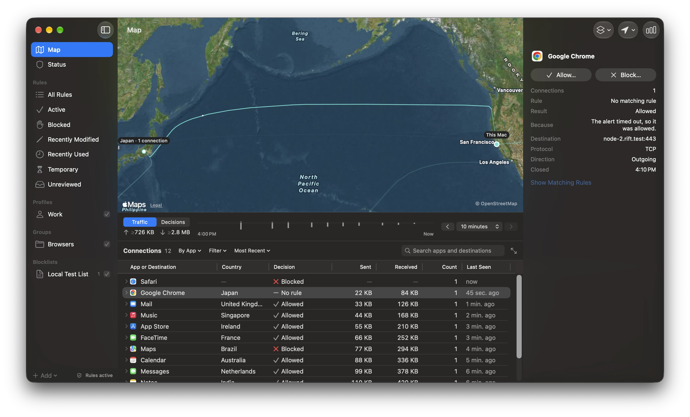

# Rift

Rift is an open-source network firewall for Apple silicon Macs. It shows which
apps connect where, draws each connection's likely route across the world's
undersea cables, and lets you allow or block apps and sites.



> **Early release.** Signed live-filtering, clean-install, fault, and soak
> testing are not complete. Don't treat Rift as an independently verified
> firewall.

## Features

- **Modes:** Ask Me, Allow and Watch, Block Unless Allowed, and Pause Rules.
- **Rules** for apps and sites, organized with profiles, groups, and local
  blocklists.
- **Connection alerts** in Ask Me mode, so you decide when an app connects
  somewhere new.
- **Map** of connections over undersea cables, with a timeline and a searchable
  connection table. Routes are estimates.
- **Menu-bar panel** with the current mode and recent apps.
- **`riftctl`**, a command-line client inside the app at
  `Rift.app/Contents/Helpers/riftctl`.
- **Automatic updates**, signed and notarized.

## Requirements

- Apple silicon Mac
- macOS 15 or later

## Install

1. Download the `.zip` from the
   [latest release](https://github.com/kewonit/rift/releases/latest) and open it.
2. Move Rift to the Applications folder and open it from there. macOS only runs
   Rift's filter from the Applications folder.
3. Approve the system extension and network filter when macOS asks.

Rift checks GitHub for updates once a day. Turn this off in Settings › General.

## Privacy

- Rift doesn't collect packet contents or full URLs, has no analytics, and
  doesn't upload diagnostics.
- Connection history stays in memory unless you turn on saved history.
- The map finds each connection's country in a table bundled with the app. Apple
  Maps loads map imagery but gets no connection details from Rift.
- The daily update check sends nothing about your connections, rules, or Mac.

Read the [privacy notice](PRIVACY.md) for details.

## Safety

If Rift has no valid policy, it allows connections instead of blocking them.
Read [runtime limitations and recovery](docs/release/runtime-limitations.md)
before you rely on it, and to remove it cleanly.

## Build from source

Requires Xcode 26.6 or later.

```sh
./Scripts/test-nonfiltering.sh
```

This runs the package tests and builds an unsigned Release copy. An unsigned
copy runs the interface but can't filter. The content filter needs an Apple
Developer Program team with the Network Extension and System Extension
capabilities; see the [build and signing guide](docs/release/build-signing.md).
The repository contains no signing identities, profiles, or credentials.

Run `./Scripts/release-local-audit.sh` before you open a pull request.

## Documentation

- [Changelog](CHANGELOG.md)
- [Privacy notice](PRIVACY.md)
- [Threat model](docs/security/threat-model.md)
- [Runtime limitations and recovery](docs/release/runtime-limitations.md)
- [Build and signing](docs/release/build-signing.md)
- [Third-party notices](THIRD_PARTY_NOTICES.md),
  [SBOM](docs/release/sbom.spdx.json), and
  [reproducibility notes](docs/release/reproducibility.md)

## Contributing

Read the [contribution guide](CONTRIBUTING.md). Report vulnerabilities
privately as described in the [security policy](SECURITY.md).

## License

[Apache License 2.0](LICENSE)
